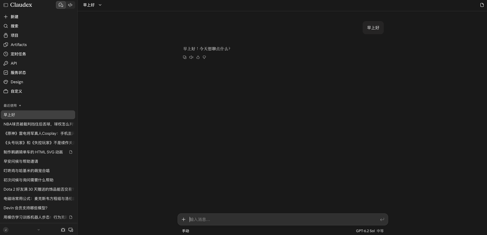
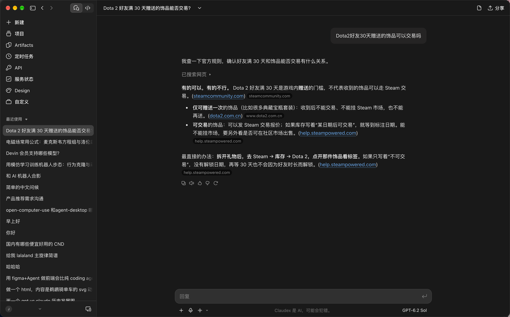
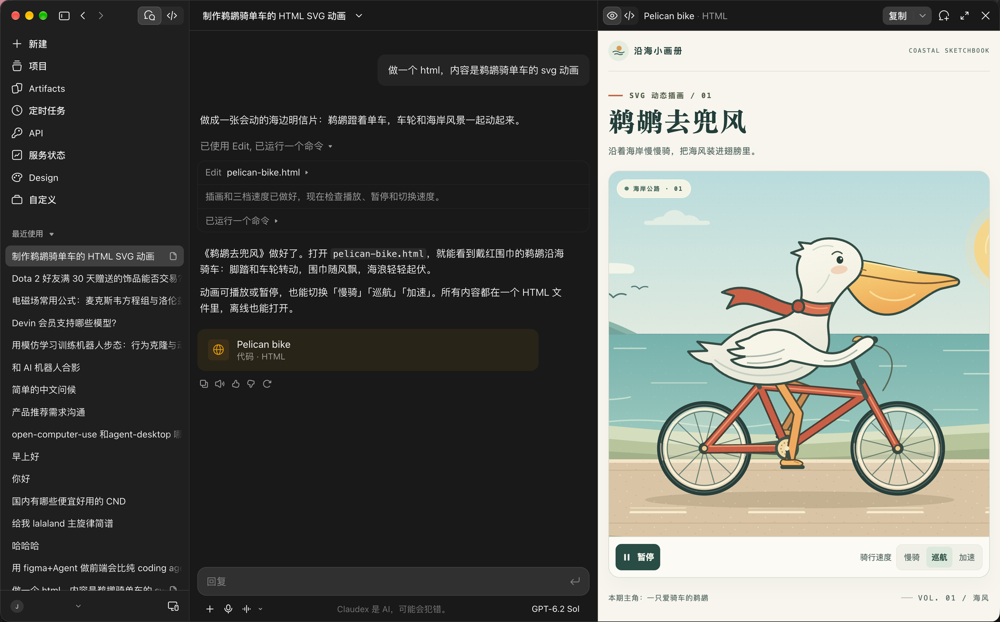
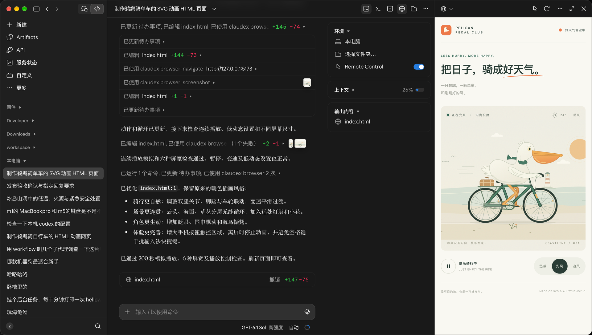
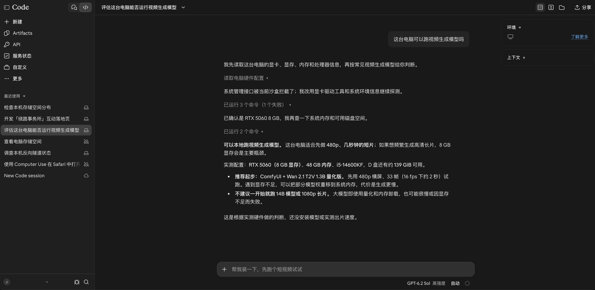

# Claudex

Claudex 是基于开源 Codex 执行引擎的桌面聊天与开发工作台。用**对话**梳理问题、整理材料或生成文档。切换到 **Code** 后，可以在选定的工作目录里读写文件、执行命令并查看结果。

[立即在线体验](https://claudex.zecous.cn/)

[下载本地版](https://github.com/ZecousJ/Open-Claude-Desktop/releases/latest) · [本地版使用手册](docs/local.md) · [完整版部署手册](docs/self-hosted.md) · [服务参数参考](docs/self-hosted-configuration.md)

## 使用方式

- **对话**支持 Markdown 回复、会话历史和项目整理。模型菜单显示当前连接提供的可用模型。
- **Code**支持在本机工作目录运行任务。通过会话工具栏查看终端、更改、浏览器和文件，展开对话里的命令步骤可查看执行结果。

桌面工作区使用 Claudex 线上 0.0.55 的界面资源。本地版首次启动提供模型连接页，Web、云端同步及远程控制需要自托管服务支持。

## 功能示例

### 日常对话

在 Chat 中提问、整理材料或继续之前的对话。侧栏可以搜索和打开已有会话。

### 含网页搜索的对话

模型渠道支持网页搜索时，可以在同一条对话中查资料。回复会显示引用，方便回到来源核对。

### 网页预览

在对话中生成 HTML 后，从产物卡片打开预览。可以在侧栏直接试用网页，再切换到代码查看实现。

### Code 对话

选择工作目录后，让 Code 读取文件、执行命令或修改项目。展开步骤可以查看执行记录，通过浏览器面板检查改动后的页面。

### 浏览器远程控制

在完整版中，启用远程控制后，可以从网页端打开已连接桌面设备的 Code 会话，查看执行结果并继续发送指令。

## 选择版本

| 功能 | 本地版 | 完整版 |
| --- | --- | --- |
| 进入工作区 | 填写自己的模型 API 地址、密钥和模型 | 登录自己部署的 Claudex 服务 |
| 模型来源 | 支持 OpenAI 兼容的 Responses 和 Chat Completions 接口 | 由 Sub2API 分组、渠道、上游账号和模型目录提供 |
| 会话记录 | 保存到当前设备 | 本地与云端会话按执行环境保存 |
| Code 执行 | 客户端内置 Codex，使用本机目录和工具 | 支持本机执行，也可把云端任务发给部署好的 Linux Runner |
| Web 与远程功能 | 适用于单机使用 | 可配置 Web 登录、云端会话和远程控制 |
| 获取方式 | GitHub Releases 提供 Apple Silicon DMG 和 Windows x64 安装程序 | 提供源码，由部署方构建客户端 |

两个版本使用各自的应用数据目录。备份本地版时，备份完整的应用数据目录。模型密钥由系统凭据加密，迁移到另一台设备时重新填写密钥。 [本地版数据与构建](docs/local.md)

## 安装本地版

1. 在 [GitHub Releases](https://github.com/ZecousJ/Open-Claude-Desktop/releases/latest) 下载对应平台的安装包。macOS 打开 DMG 后将 Claudex Local 拖入「应用程序」。Windows 运行安装程序。
2. 填写可访问的模型 API 地址，例如 `https://api.example.com/v1`，再填上游发放的 API 密钥和模型 ID。也可以填写完整的 `/v1/responses` 或 `/v1/chat/completions` 地址，客户端会识别协议。
3. 进入工作区后，先发送一条消息验证模型连接。要用 Code 时，切换到 Code、选一个你信任的本地目录，再让它运行项目中的命令。

首次连接成功后可以直接开始对话。客户端启动内置的 Codex 执行引擎，模型请求发往你填写的 API。安装包的签名和验证状态见发行说明。 [协议和打包说明](docs/local.md)

## 部署完整版

1. 从 `backend/` 构建本仓库的 Sub2API 服务端，使用 Compose 启动 PostgreSQL、Redis 和服务端，再配置 HTTPS。
2. 在后台添加上游 API Key 账号，绑定模型分组并配置价格、用户额度和设备 Key。需要邮箱登录时配置 SMTP，按需启用支付、附件对象存储和听写。
3. 在后台注册 Linux Runner，将令牌保存到 Runner 主机并启动服务。开启网页端时，构建 Web 应用并挂载到 Claudex 服务端。
4. 构建客户端前设置 `CLAUDEX_SUB2API_URL` 为自己的服务根地址。客户端从该服务读取账号权限、模型目录和运行环境。

[从零部署完整版](docs/self-hosted.md) · [SMTP、支付回调、附件存储和 Runner 参数](docs/self-hosted-configuration.md) · [服务端备份与恢复](deploy/claudex-server/README.md#备份与恢复--backup-and-restore)

## 源码目录

| 目录 | 用途 |
| --- | --- |
| [`src/`](src/) | 桌面对话、Code 和设置界面 |
| [`electron/`](electron/) | 桌面进程、账号、执行引擎、工作目录与文件操作 |
| [`src-web/`](src-web/) | Web 客户端和到服务端的桥接 |
| [`runner/`](runner/) | Linux Runner 和任务隔离 |
| [`backend/`](backend/) | Claudex 服务端与 Sub2API 管理后台 |
| [`deploy/`](deploy/) | Compose、反向代理、初始化和部署脚本 |

桌面打包时使用随 Release 提供的工作区资源。托管环境中的账号、模型目录、存储地址和运维凭据由部署方配置。

桌面端、Web 和 Runner 使用 Apache-2.0。仓库内的 Sub2API 分支使用 LGPL-3.0。工作区资源和第三方依赖保留各自的许可。 [LICENSE](LICENSE) · [第三方许可](THIRD_PARTY_NOTICES.md) · [Sub2API 源码声明](backend/SOURCE_OFFER.md)
